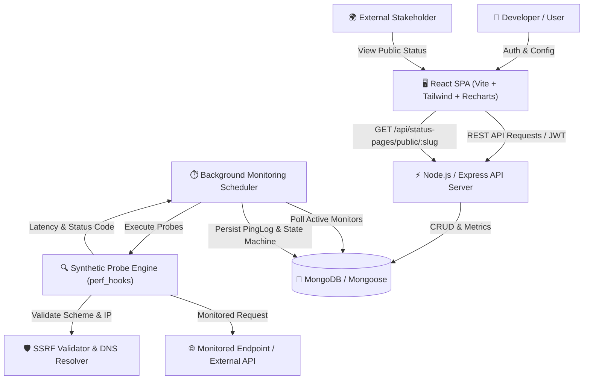
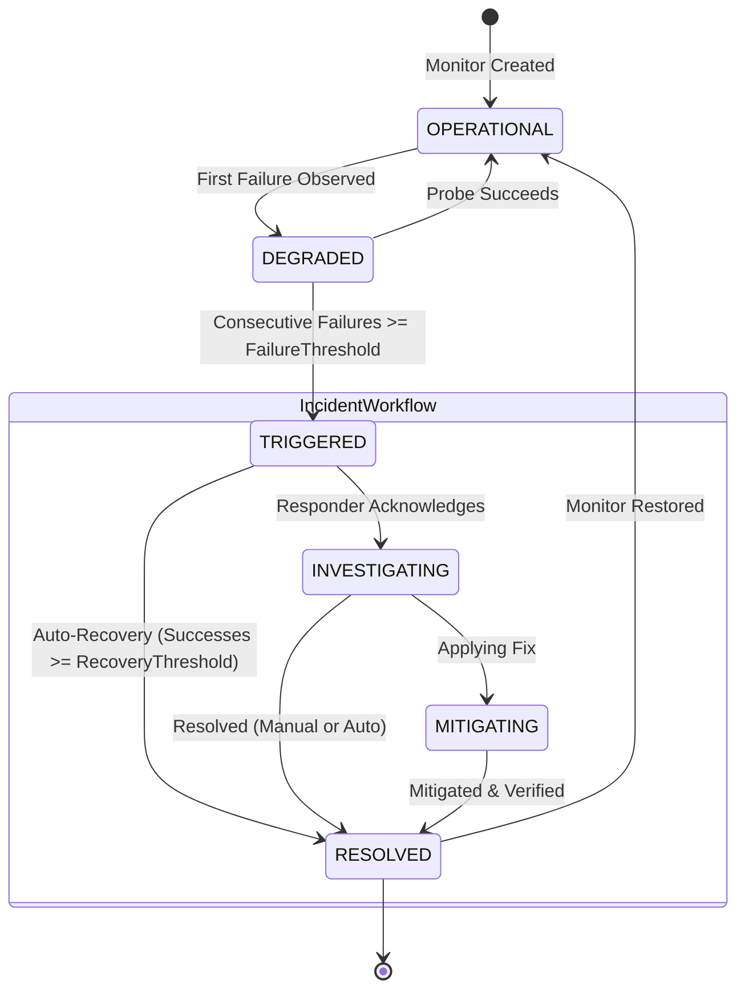

# PingCraft — Synthetic API Monitoring & Incident Response Platform

> **An end-to-end, full-stack MERN application for synthetic health monitoring, automated outage detection, incident state transitions, and public status pages.**

[](https://nodejs.org/)
[](https://opensource.org/licenses/MIT)
[]()

---

## 🔗 Project Deliverables & Submission Links

| Deliverable | Description / URL |
| :--- | :--- |
| **Live Frontend App** | [https://pingcraft-gamma.vercel.app](https://pingcraft-gamma.vercel.app) |
| **Live Backend API** | [https://pingcraft.onrender.com](https://pingcraft.onrender.com) |
| **GitHub Repository** | [https://github.com/Prakrit-Sangwan2402/pingcraft](https://github.com/Prakrit-Sangwan2402/pingcraft) |
| **Demo Video Walkthrough** | [Google Drive Demo Video (3–5 Min)](https://drive.google.com/file/d/1K5aO3FWvg8LlN3KmOg_ZQDFwCkPdWv3U/view?usp=drive_link) |
| **Automated Test Results** | **35 / 35 tests passed** across 4 suites (`npm test`) |

---

## 1. Project Overview

### Problem Statement
Modern web applications and APIs crash, encounter network partitions, degrade in latency, or return unexpected error payloads without developers knowing until end-users complain. Existing commercial solutions (e.g. Datadog, BetterStack, PagerDuty) are closed-source, expensive, or enterprise-bloated. Developers need an autonomous, lightweight synthetic monitoring platform that continuously evaluates API health, tracks precision response latencies, detects outages using configurable consecutive failure thresholds, enforces incident state workflows, and communicates transparency via public status pages.

### Target Users
- **Backend & Full-Stack Developers:** Requiring continuous verification of API contracts and response times.
- **DevOps & SRE Engineers:** Needing synthetic health probes, automated outage alerts, and incident audit trails.
- **Engineering Teams:** Wanting a branded public status page to communicate uptime SLAs to customers without exposing sensitive internal infrastructure.

### Solution
**PingCraft** is built on the MERN stack with:
1. **Autonomous Synthetic Probe Engine:** High-resolution timers (`performance.now()`) probing endpoints at configurable intervals.
2. **SSRF Defense Shield:** Strict URL validation, DNS resolution inspection, loopback/RFC 1918 private IP blocking, and header sanitization.
3. **Incident State Machine:** Deterministic transitions (`TRIGGERED` $\rightarrow$ `INVESTIGATING` $\rightarrow$ `MITIGATING` $\rightarrow$ `RESOLVED`), duplicate active incident prevention, and auto-recovery daemon.
4. **Dedicated Telemetry & Percentile Service:** Nearest-rank p95 latency calculations, rolling 24h & 7d uptime percentiles, and honest "No data" representation.
5. **Interactive Dashboard & Branded Public Status Page:** Live latency trend charts, telemetry logs, and unauthenticated public status URLs.

---

## 2. Architecture & Data Flow



---

## 3. Incident State Machine Lifecycle



### Key Incident Invariants:
- **Single Active Incident Guarantee:** A monitor can have **at most one** unresolved incident at any time (enforced via database partial unique index on `{ monitorId: 1, resolvedAt: 1 }` where `resolvedAt: null`).
- **Audit Immutability:** Incidents record the timestamp of the first observed failure (`startedAt`), detection time (`detectedAt`), and maintain an append-only timeline.
- **Auto-Recovery Daemon:** When consecutive successful checks satisfy the monitor's `recoveryThreshold`, the open incident is automatically marked `RESOLVED`, total downtime duration is computed, and the monitor returns to `OPERATIONAL`.

---

## 4. Telemetry & Metric Definitions

All metrics are computed on the backend using the dedicated `metricsService`:

| Metric | Calculation Method | Handling of Empty Telemetry |
| :--- | :--- | :--- |
| **Uptime (24h / 7d)** | $\frac{\text{Successful Executed Checks}}{\text{Total Executed Checks in Window}} \times 100$ | Returns `null` ("No data" state). **Never** falsely reports 100% when no checks exist. |
| **Mean Latency** | $\frac{\sum \text{Valid Response Latencies}}{\text{Total Valid Latencies}}$ | Returns `null` if no observations. |
| **p95 Latency** | **Nearest-Rank Percentile Method:**<br>1. Sort valid latencies ascending.<br>2. Rank $k = \lceil 0.95 \times N \rceil - 1$.<br>3. Return sorted[$k$]. | Returns `null` if no observations. |
| **Paused Monitors** | Paused monitors do not execute checks and are excluded from active health calculations. | Clearly badged as `PAUSED`. |

---

## 5. Security & SSRF Defense Shield

Because users can input arbitrary URLs for monitoring, **Server-Side Request Forgery (SSRF)** is prevented at multiple defensive layers:

1. **Protocol Restriction:** Only `http:` and `https:` schemes are accepted. Non-web schemes (`file:`, `ftp:`, `gopher:`, `javascript:`) are rejected.
2. **Prohibited IP Blacklist:**
   - **Loopback:** `127.0.0.0/8`, `::1`
   - **Private Class A, B, C:** `10.0.0.0/8`, `172.16.0.0/12`, `192.168.0.0/16`
   - **Carrier-Grade NAT:** `100.64.0.0/10`
   - **Link-Local & Cloud Metadata:** `169.254.0.0/16` (blocks AWS/Azure/GCP instance metadata `169.254.169.254`), `fe80::/10`
   - **Multicast & Reserved:** `224.0.0.0/4`, `240.0.0.0/4`, `ff00::/8`
   - **IPv4-Mapped IPv6:** `::ffff:127.0.0.1`
3. **DNS Resolution & Rebinding Defense:** Hostnames are resolved via `dns.promises.lookup({ all: true })`. Every resolved IP is validated before the HTTP request is initiated.
4. **Header Sanitization:** Forbidden headers (`Host`, `Cookie`, `Authorization`, `X-Forwarded-*`, `Connection`) cannot be spoofed or forwarded to monitored targets.
5. **No Automatic Redirects:** Probes use `redirect: 'manual'` to prevent open redirect bypasses into private intranets.
6. **Payload Bomb Protection:** Response streams are capped at 1 MB; requests exceeding the limit are immediately aborted.

---

## 6. Technology Stack

- **Frontend:** React 18, Vite, Tailwind CSS, Recharts (time-series area charts), Lucide React.
- **Backend:** Node.js (v18+), Express.js.
- **Database:** MongoDB & Mongoose (with MongoDB Atlas support and seamless dev/test fallback).
- **Security:** Bcrypt (password hashing), JSON Web Tokens (JWT), Express Rate Limit, Helmet.
- **Testing:** Jest, Supertest, MongoMemoryServer.

---

## 7. API Reference

### Authentication (`/api/auth`)
| Method | Endpoint | Description | Auth Required |
| :--- | :--- | :--- | :--- |
| `POST` | `/api/auth/register` | Create user account (rate-limited) | No |
| `POST` | `/api/auth/login` | Authenticate user & receive JWT | No |
| `GET` | `/api/auth/me` | Fetch currently authenticated user | Yes |

### Monitors (`/api/monitors`)
| Method | Endpoint | Description | Auth Required |
| :--- | :--- | :--- | :--- |
| `GET` | `/api/monitors` | List monitors with filter & search | Yes |
| `POST` | `/api/monitors` | Create new monitor (SSRF checked) | Yes |
| `GET` | `/api/monitors/:id` | Get monitor with 24h/7d metrics & charts | Yes |
| `PUT` | `/api/monitors/:id` | Update monitor configuration | Yes |
| `DELETE` | `/api/monitors/:id` | Delete monitor and telemetry logs | Yes |
| `PATCH` | `/api/monitors/:id/pause` | Toggle pause/resume status | Yes |
| `POST` | `/api/monitors/instant-probe` | Run instant synthetic probe on URL | Yes |
| `GET` | `/api/monitors/:id/logs` | Paginated historical ping logs | Yes |

### Incidents (`/api/incidents`)
| Method | Endpoint | Description | Auth Required |
| :--- | :--- | :--- | :--- |
| `GET` | `/api/incidents` | List incidents (filter by status) | Yes |
| `GET` | `/api/incidents/:id` | Get incident details & timeline | Yes |
| `PATCH` | `/api/incidents/:id/status` | Transition incident workflow state | Yes |

### Status Pages (`/api/status-pages`)
| Method | Endpoint | Description | Auth Required |
| :--- | :--- | :--- | :--- |
| `GET` | `/api/status-pages/public/:slug` | View public status page (unauthenticated) | **No** |
| `GET` | `/api/status-pages/me` | Get status page configuration | Yes |
| `PUT` | `/api/status-pages/me` | Update status page slug & components | Yes |

### Health Check (`/api/health`)
| Method | Endpoint | Description | Auth Required |
| :--- | :--- | :--- | :--- |
| `GET` | `/api/health` | System readiness, DB state & memory | No |

---

## 8. Local Setup Instructions

### Prerequisites
- Node.js (v18.0.0 or higher)
- npm (v9.0.0 or higher)

### 1. Clone the Repository
```bash
git clone <your-repo-url>
cd "END-TERM PROJECT MERN"
```

### 2. Configure Backend Environment
```bash
cd backend
cp .env.example .env
```
*(In development, if `MONGODB_URI` is omitted, the backend automatically uses an embedded in-memory database instance for zero-configuration local evaluation!)*

### 3. Run Automated Tests
```bash
cd backend
npm test
```
*Executes all 35 tests covering SSRF security, incident state machine, metrics formulas, and API endpoints.*

### 4. Start the Application

**Option A: Running Backend & Frontend Concurrently**
In Terminal 1 (Backend API & Background Worker):
```bash
cd backend
npm run dev
# Server listening on http://localhost:5000
```

In Terminal 2 (Frontend Client):
```bash
cd frontend
npm run dev
# Frontend live at http://localhost:5173
```

---

## 9. Manual Verification & Demo Script (3–5 Minutes)

Follow this procedure to demonstrate the full workflow in your demo video:

1. **User Registration & Login (0:00 - 0:45)**
   - Open `http://localhost:5173`.
   - Register a new account (`devops@example.com` / `Password123!`).
   - Notice the secure JWT stored and the dashboard opening with system KPI cards.
2. **Instant Probe & SSRF Protection Test (0:45 - 1:30)**
   - Click **Instant Probe**.
   - Test `http://localhost:5000/api/health` $\rightarrow$ Observe the SSRF shield blocking loopback access!
   - Test `https://httpbin.org/status/200` $\rightarrow$ Observe instant response code `HTTP 200`, exact response latency (e.g., `142 ms`), and payload size.
3. **Monitor Creation & Baseline Telemetry (1:30 - 2:30)**
   - Click **Add Monitor**.
   - Name: `Production API Gateway`, URL: `https://httpbin.org/status/200`, Interval: `15s`, Failure SLA: `2`.
   - Open monitor details: show the real-time latency chart (Recharts) and rolling 24h uptime.
4. **Simulating Outage & Automated Incident Generation (2:30 - 3:45)**
   - Edit the monitor target URL to an endpoint returning failure: `https://httpbin.org/status/500`.
   - On the next probe tick, the monitor transitions to **DEGRADED**.
   - After 2 consecutive failures, status flips to **DOWN (Major Outage)** and an **Active Outage Incident** is automatically generated.
   - Open the **Incident War Room**: transition status from `TRIGGERED` $\rightarrow$ `INVESTIGATING` with responder notes.
5. **Auto-Recovery & Public Status Page (3:45 - 4:45)**
   - Revert URL back to `https://httpbin.org/status/200`.
   - The auto-recovery daemon observes 2 consecutive successes, automatically transitions the incident to **RESOLVED**, logs the downtime duration, and restores status to **OPERATIONAL**.
   - Navigate to **Status Page Settings** $\rightarrow$ Click **View Live Page** (`/#/status/:slug`) to demonstrate the branded public status page.

---

## 10. Known Limitations

- **Distributed Probes:** Synthetic probes currently originate from the single server/worker host rather than globally distributed edge locations (e.g., US-East vs EU-West).
- **Webhook Integrations:** Alert transitions are logged to the in-app War Room; external Slack/Discord webhook dispatchers can be integrated as an external notification channel.
- **WebSocket Push:** The frontend dashboard currently uses configurable interval polling (15s); WebSockets can be added for instantaneous UI event pushes.

---

## 11. Final Submission Details

- **Project Name:** PingCraft
- **Tech Stack:** MERN (MongoDB Atlas, Express, React 18, Node.js), Tailwind CSS, Recharts
- **Live Frontend App:** [https://pingcraft-gamma.vercel.app](https://pingcraft-gamma.vercel.app)
- **Live Backend API:** [https://pingcraft.onrender.com](https://pingcraft.onrender.com)
- **GitHub Repository:** [https://github.com/Prakrit-Sangwan2402/pingcraft](https://github.com/Prakrit-Sangwan2402/pingcraft)
- **Demo Video (3–5 Min):** [Watch Demo Walkthrough on Google Drive](https://drive.google.com/file/d/1K5aO3FWvg8LlN3KmOg_ZQDFwCkPdWv3U/view?usp=drive_link)
- **Automated Tests:** 35 passing unit and integration tests (SSRF, Metrics/P95, Incident State Machine, E2E Workflows)
